# Płatności PayU w alf.io: przewodnik dla uczestników i organizatorów

*Ostatnia aktualizacja: 7 listopada 2026 · wersja: gałąź `plo-pl` (fork alf.io dla zjazdu XX-lecia PLO PŁ)*

## TL;DR
- Uczestnik wybiera na stronie płatności opcję **„PayU: BLIK, szybki przelew, karta”**, klika **„Zapłać”** i płaci na stronie PayU. Potem wraca do alf.io i dostaje potwierdzenie rezerwacji.
- Jeśli uczestnik przerwie płatność, wraca do podsumowania zamówienia z komunikatem i może spróbować jeszcze raz.
- Administrator wpisuje sześć ustawień PayU w panelu **PayU** (ustawienia systemowe **albo** organizacji, nigdy na obu poziomach) i zaznacza PayU w ustawieniach wydarzenia.
- Płatności PayU widać w rezerwacjach z oznaczeniem `PAYU`. Zwrot robi się ze szczegółów rezerwacji.
- Przed startem sprzedaży przejdź checklistę uruchomienia (na końcu dokumentu).

## Key Decisions
- **Zrzuty ekranu pochodzą z lokalnego serwera testowego w wersji angielskiej.** Polskie napisy (z gałęzi `fix/pl-translations`) podajemy w tekście, np. „PayU: BLIK, szybki przelew, karta”, „Zapłać”, „Proszę czekać”, „Wymuś sprawdzenie”.
- **Zrzuty wykorzystane ponownie z testów E2E** (`verification/screenshots/`). Jedyny nowy zrzut to sekcja zwrotu w szczegółach rezerwacji (`23-admin-reservation-refund.png`).
- **Panel PayU pokazujemy na zrzucie z pustymi polami** (poziom organizacji). Zrzutu z wypełnionymi kluczami celowo nie używamy, żeby nie pokazywać wartości tajnych.
- Nazwy ustawień (`PAYU_ENABLED`, `PAYU_LIVE_MODE` itd.) zostawiamy w oryginale, bo tak widnieją w panelu i w dokumentacji technicznej.

## Open Questions / Risks
- **Komunikat „The confirmation is taking longer than expected” nie ma polskiego tłumaczenia.** Klucz to `reservation.payment-processing.delay.message`. Polski uczestnik zobaczy go po angielsku, obok polskiego przycisku „Wymuś sprawdzenie”. Warto dodać tłumaczenie na gałęzi `fix/pl-translations`.
- **Pola z kluczami PayU w panelu nie są maskowane.** `client_secret` i second key widać jako zwykły tekst. Nie rób zrzutów ekranu tego panelu i nie udostępniaj go przy innych osobach.
- **Ponowny zwrot może zwrócić pieniądze drugi raz.** Jeśli zwrot „nie wyszedł”, najpierw sprawdź w panelu PayU, czy pieniądze nie zostały już zwrócone. Dopiero potem próbuj ponownie.

---

## Spis treści

**Część 1: dla uczestnika**
1. [Czym jest płatność PayU?](#1-czym-jest-płatność-payu)
2. [Jak zapłacić przez PayU](#2-jak-zapłacić-przez-payu)
3. [Ekran „Proszę czekać”: co się dzieje?](#3-ekran-proszę-czekać-co-się-dzieje)
4. [Co zrobić, gdy płatność zostanie przerwana](#4-co-zrobić-gdy-płatność-zostanie-przerwana)
5. [Najczęstsze pytania uczestników](#5-najczęstsze-pytania-uczestników)

**Część 2: dla organizatora i administratora**

6. [Konfiguracja PayU w panelu](#6-konfiguracja-payu-w-panelu)
7. [Włączenie PayU w wydarzeniu](#7-włączenie-payu-w-wydarzeniu)
8. [Gdzie widać płatności PayU](#8-gdzie-widać-płatności-payu)
9. [Zwrot pieniędzy (refund)](#9-zwrot-pieniędzy-refund)
10. [Checklista uruchomienia produkcyjnego](#10-checklista-uruchomienia-produkcyjnego)
11. [Rozwiązywanie problemów (organizator)](#11-rozwiązywanie-problemów-organizator)

---

# Część 1: dla uczestnika

## 1. Czym jest płatność PayU?

PayU to polski operator płatności internetowych. Dzięki niemu możesz zapłacić za bilet na zjazd tak, jak płacisz w sklepach internetowych:

- **BLIK**: kod z aplikacji Twojego banku,
- **szybki przelew** (pay-by-link): logujesz się do swojego banku i zatwierdzasz gotowy przelew,
- **karta płatnicza**: debetowa lub kredytowa (Visa, Mastercard),
- zależnie od konfiguracji PayU także Apple Pay / Google Pay.

📝 **Ważne**: danych karty ani loginu do banku nie wpisujesz w systemie rezerwacji. Podajesz je wyłącznie na bezpiecznej stronie PayU.

## 2. Jak zapłacić przez PayU

**Co będzie potrzebne**:
- telefon z aplikacją banku (dla BLIK) **albo** dostęp do bankowości internetowej **albo** karta płatnicza,
- kilka minut: na dokończenie zamówienia masz ograniczony czas, licznik widać u góry strony.

**Kroki**:

1. **Wybierz bilety i wpisz swoje dane**

   Na stronie wydarzenia wybierz bilet, kliknij przycisk przejścia dalej i wypełnij dane kontaktowe. Po zatwierdzeniu trafisz na stronę **podsumowania zamówienia** z sekcją **„Płatność”**.

   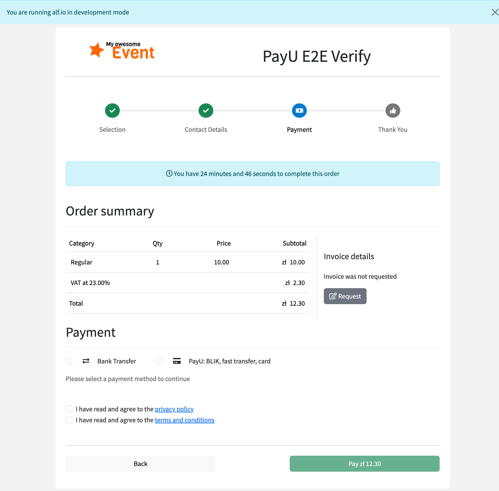

   💡 **Wskazówka**: niebieski pasek u góry pokazuje, ile czasu zostało na dokończenie zamówienia.

2. **Wybierz „PayU: BLIK, szybki przelew, karta”**

   W sekcji „Płatność” zaznacz opcję **PayU: BLIK, szybki przelew, karta** (z ikoną karty). Pod spodem pojawi się opis: *„Zostaniesz przekierowany na bezpieczną stronę płatności PayU, aby dokończyć zakup.”*

   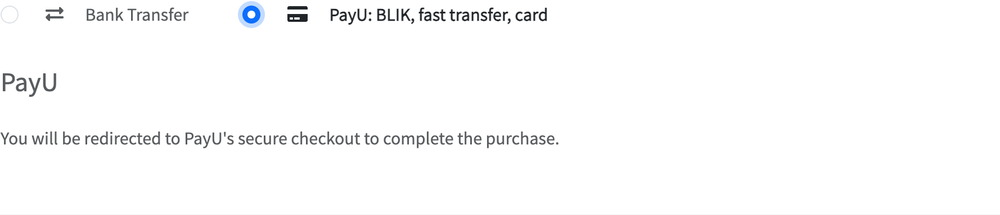

   ℹ️ Na zrzucie widać angielską wersję napisów. W polskiej wersji strony opcja nazywa się „PayU: BLIK, szybki przelew, karta”.

3. **Zaakceptuj zgody i kliknij „Zapłać”**

   Zaznacz wymagane zgody (polityka prywatności, regulamin), a potem kliknij zielony przycisk **„Zapłać”** z kwotą, np. „Zapłać zł 12.30”.

   ⚠️ **Kliknij tylko raz.** Przycisk znika na chwilę, a strona przenosi Cię do PayU. Gdybyś jednak kliknął dwa razy albo wrócił i spróbował ponownie, system nie pobierze pieniędzy dwukrotnie.

4. **Zapłać na stronie PayU**

   Zobaczysz stronę PayU z kwotą i Twoim adresem e-mail. Wybierz sposób płatności:
   - **BLIK**: wpisz 6-cyfrowy kod z aplikacji banku i potwierdź płatność w aplikacji,
   - **Przelew bankowy**: wybierz swój bank, zaloguj się i zatwierdź przelew,
   - **Karta płatnicza**: wpisz dane karty i potwierdź (np. w aplikacji banku).

   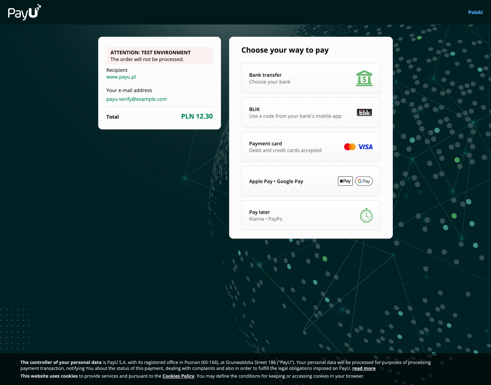

   ℹ️ Zrzut pochodzi ze środowiska testowego PayU (stąd napis „ATTENTION: TEST ENVIRONMENT”). Na prawdziwej stronie tego napisu nie ma.

5. **Wróć do strony wydarzenia**

   Po zatwierdzeniu płatności PayU automatycznie przeniesie Cię z powrotem do systemu rezerwacji. Przez chwilę możesz zobaczyć ekran **„Proszę czekać”**, a potem stronę z potwierdzeniem. Więcej o tym ekranie w [rozdziale 3](#3-ekran-proszę-czekać-co-się-dzieje).

6. **Gotowe: rezerwacja potwierdzona**

   ✅ **Co powinieneś zobaczyć**: zielony komunikat o zakończonej rezerwacji, swoje bilety oraz informację, że na Twój adres e-mail wysłaliśmy potwierdzenie.

   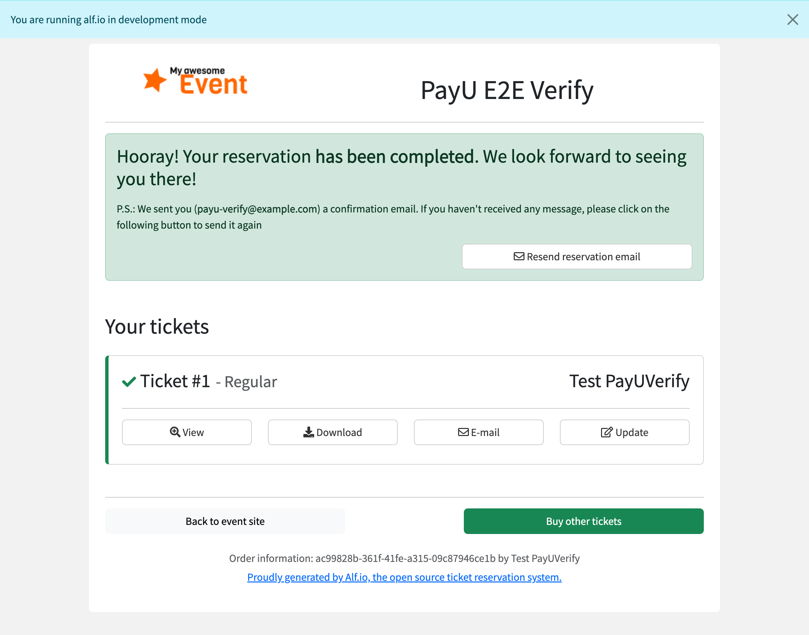

   💡 **Wskazówka**: jeśli e-mail nie dotrze w ciągu kilku minut, sprawdź folder SPAM albo kliknij „Wyślij ponownie e-mail z rezerwacją”.

## 3. Ekran „Proszę czekać”: co się dzieje?

Po powrocie z PayU system musi otrzymać od PayU potwierdzenie, że pieniądze naprawdę wpłynęły. Zwykle trwa to kilka sekund. W tym czasie widzisz podsumowanie zamówienia i niebieski pasek **„Proszę czekać”**.

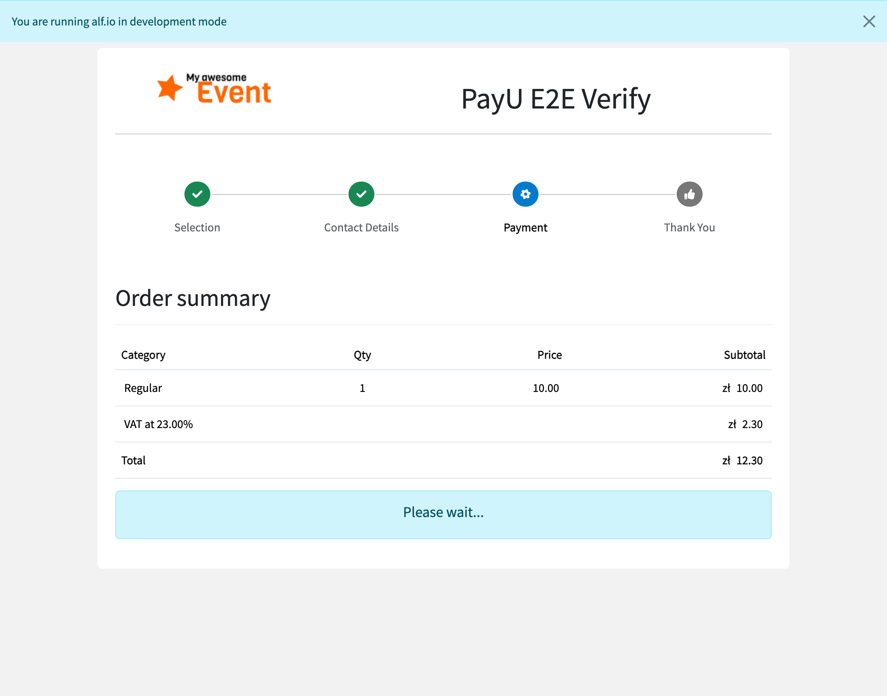

**Co robić**: nic. Nie zamykaj strony i nie płać drugi raz. Strona sama przejdzie do potwierdzenia.

**Gdy trwa to dłużej**: jeśli bank potwierdza płatność wolniej, pojawi się komunikat, że potwierdzenie trwa dłużej niż zwykle, oraz przycisk **„Wymuś sprawdzenie”**.

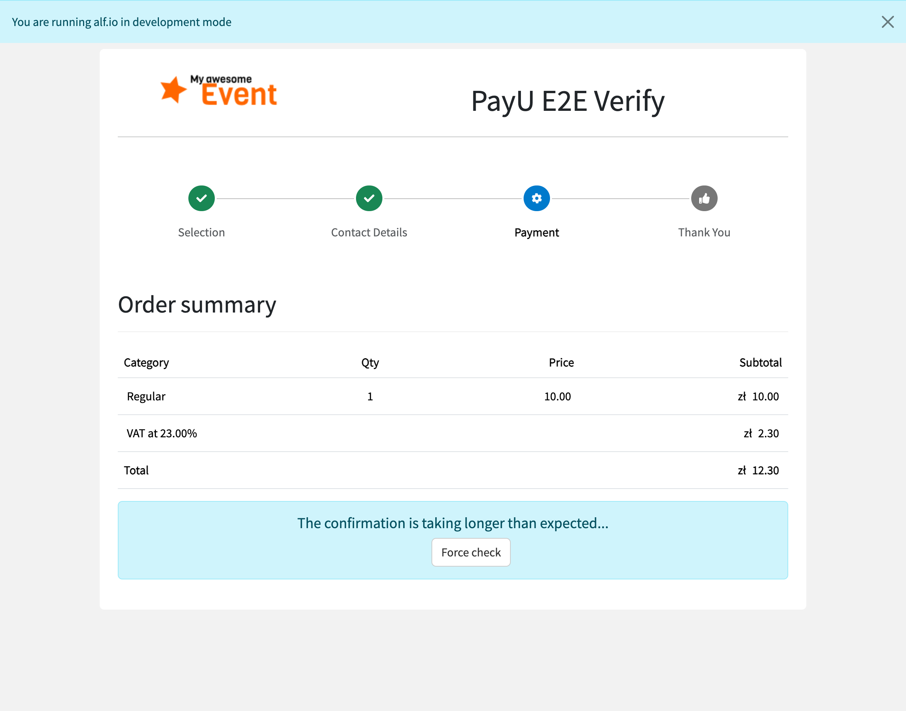

Kliknij **„Wymuś sprawdzenie”**: system zapyta PayU o stan płatności. Jeśli płatność jest już zaksięgowana, zobaczysz potwierdzenie rezerwacji.

⚠️ **Zamknąłeś przeglądarkę albo straciłeś połączenie po zapłaceniu?** Nic straconego. PayU i tak powiadomi system o płatności, a potwierdzenie rezerwacji przyjdzie e-mailem. Nie płać drugi raz. Jeśli e-mail nie przyjdzie w ciągu kilkunastu minut, skontaktuj się z organizatorami.

## 4. Co zrobić, gdy płatność zostanie przerwana

Płatność może się nie udać, na przykład gdy:
- klikniesz „Anuluj” / „Wróć do sklepu” na stronie PayU,
- odrzucisz płatność BLIK w aplikacji banku,
- bank odrzuci kartę albo przelew.

Wtedy PayU odeśle Cię do systemu rezerwacji, na stronę **podsumowania zamówienia**. W rogu pojawi się czerwony komunikat:

> **„Płatność nie została zakończona. Możesz wybrać metodę płatności i spróbować ponownie.”**

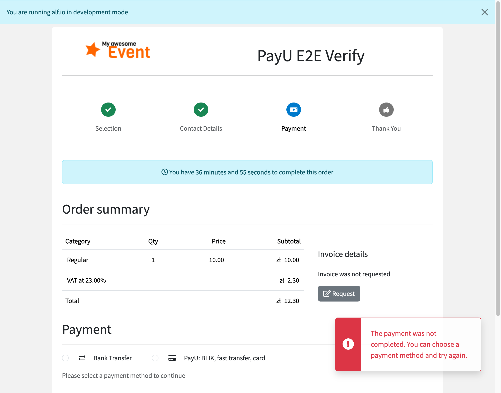

**Co dalej**:

1. Sprawdź, czy zamówienie jest nadal ważne: licznik czasu u góry pokazuje, ile czasu zostało.
2. Wybierz ponownie metodę płatności, np. jeszcze raz **„PayU: BLIK, szybki przelew, karta”** albo przelew tradycyjny, jeśli organizator go udostępnia.
3. Zaznacz zgody i kliknij **„Zapłać”**. Zostaniesz przeniesiony do nowej płatności w PayU.

✅ **Pieniądze nie zostały pobrane.** Przerwana płatność jest anulowana po stronie PayU, więc druga próba nie oznacza podwójnej opłaty.

💡 **Wskazówka**: komunikat pokazuje się tylko raz. Po odświeżeniu strony zniknie, ale zamówienie nadal czeka na płatność.

## 5. Najczęstsze pytania uczestników

**Zapłaciłem, ale strona dalej pokazuje „Proszę czekać”.**
Poczekaj chwilę i kliknij „Wymuś sprawdzenie”, gdy się pojawi. Nie płać ponownie. Jeśli po kilkunastu minutach nadal nie ma potwierdzenia, napisz do organizatorów i podaj numer zamówienia.

**Czas na dokończenie zamówienia minął w trakcie płatności.**
Gdy płatność w PayU się rozpoczęła, system przedłuża ważność zamówienia na czas płatności. Jeśli jednak płatność nie dojdzie do skutku, zamówienie wygaśnie i trzeba będzie złożyć je od nowa.

**Widzę komunikat „Wystąpił nieoczekiwany błąd podczas komunikacji z PayU”.**
Połączenie z PayU chwilowo nie działa. Spróbuj ponownie za kilka minut albo wybierz inną metodę płatności. Jeśli błąd się powtarza, skontaktuj się z organizatorami.

**Nie widzę opcji PayU.**
Organizator nie włączył jej w tym wydarzeniu albo waluta biletów nie jest obsługiwana przez PayU. Skorzystaj z innej dostępnej metody lub zapytaj organizatorów.

---

# Część 2: dla organizatora i administratora

## 6. Konfiguracja PayU w panelu

Ustawienia PayU wpisujesz raz, a potem możesz włączać PayU w kolejnych wydarzeniach.

**Co będzie potrzebne** (z panelu sprzedawcy PayU, zakładka punktu płatności / POS):
- **POS ID** (identyfikator punktu płatności, `merchantPosId`),
- **client_id** i **client_secret** (dane OAuth),
- **Drugi klucz (MD5)** (second key), do sprawdzania podpisu powiadomień od PayU.

📝 Do testów używaj danych ze środowiska **sandbox** PayU. Do sprzedaży biletów potrzebne są dane **produkcyjnego** punktu płatności.

**Kroki**:

1. **Otwórz ustawienia**

   W panelu administracyjnym (`/admin`) kliknij w górnym menu **Configuration**. Po lewej wybierz poziom:
   - **System**: ustawienia dla całej instalacji,
   - **nazwa organizacji** (np. organizacja zjazdu): ustawienia tylko dla tej organizacji.

   ⚠️ **Wszystkie sześć ustawień PayU wpisz na jednym poziomie**: albo wszystkie w ustawieniach systemowych, albo wszystkie w ustawieniach organizacji. Jeśli wpiszesz część na jednym poziomie, a część na drugim, system może połączyć klucze z dwóch różnych punktów płatności i płatności przestaną działać.

2. **Znajdź panel „PayU”**

   Przewiń do sekcji płatności. Pod panelem Saferpay znajduje się panel **PayU** z ikoną karty.

   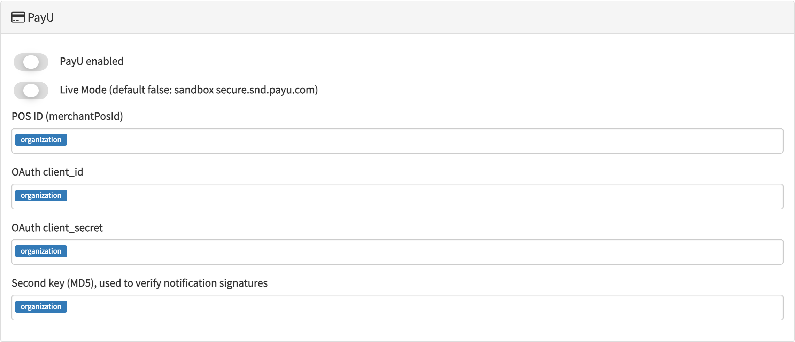

3. **Wypełnij ustawienia**

   | Pole w panelu | Nazwa ustawienia | Co wpisać |
   |---|---|---|
   | PayU enabled | `PAYU_ENABLED` | włącz przełącznik |
   | Live Mode | `PAYU_LIVE_MODE` | **wyłączone** = test (sandbox), **włączone** = prawdziwe płatności |
   | POS ID (merchantPosId) | `PAYU_POS_ID` | identyfikator punktu płatności |
   | OAuth client_id | `PAYU_CLIENT_ID` | client_id z panelu PayU |
   | OAuth client_secret | `PAYU_CLIENT_SECRET` | client_secret z panelu PayU |
   | Second key (MD5) | `PAYU_SECOND_KEY` | drugi klucz MD5 z panelu PayU |

   ⚠️ **Live Mode musi pasować do kluczy.** Klucze z sandboxa działają tylko z wyłączonym Live Mode, a klucze produkcyjne tylko z włączonym.

   ⚠️ **Klucze są tajne.** Pola nie są maskowane, więc nie rób zrzutów tego ekranu i nie udostępniaj go innym osobom.

4. **Zapisz zmiany**

   Kliknij przycisk zapisu na dole strony.

   ✅ **Co powinieneś zobaczyć**: przy każdym polu pojawia się etykieta poziomu (`system` lub `organization`) i przycisk kosza do usunięcia wartości.

💡 **Wskazówka**: adresu powiadomień nie trzeba wpisywać w panelu PayU. System przekazuje go automatycznie przy każdej płatności. Musi być jednak poprawnie ustawiony publiczny adres instalacji (`BASE_URL`), patrz [rozdział 10](#10-checklista-uruchomienia-produkcyjnego).

## 7. Włączenie PayU w wydarzeniu

Sama konfiguracja nie pokazuje jeszcze PayU uczestnikom. Trzeba ją włączyć w każdym wydarzeniu.

1. Otwórz wydarzenie w panelu administracyjnym i kliknij **Edit** w sekcji **Seats and payment info**.
2. W liście **Accepted payment methods** zaznacz **PayU: BLIK, fast transfer, card**. Możesz zostawić też inne metody, np. przelew tradycyjny.

   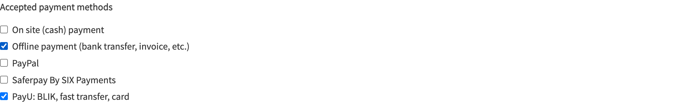

3. Zapisz wydarzenie.

   ✅ **Co powinieneś zobaczyć**: w szczegółach wydarzenia, w polu **Payment methods**, widnieje „PayU: BLIK, fast transfer, card”.

   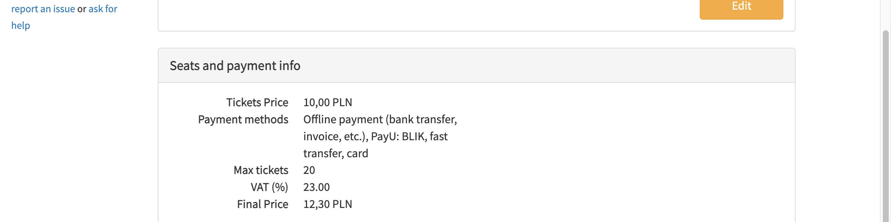

📝 **Waluta**: PayU obsługuje m.in. PLN, EUR, USD, CZK, GBP, HUF, RON, BGN, DKK, NOK, SEK i CHF. Na zjazd ustaw ceny w **PLN**. Jeśli wydarzenie ma walutę, której PayU nie obsługuje, opcja PayU nie pojawi się uczestnikom.

## 8. Gdzie widać płatności PayU

**Lista rezerwacji**: w wydarzeniu wybierz z menu po lewej **Reservations**. W kolumnie **PAYMENT** rezerwacje opłacone przez PayU mają ikonę karty i oznaczenie `PAYU`.

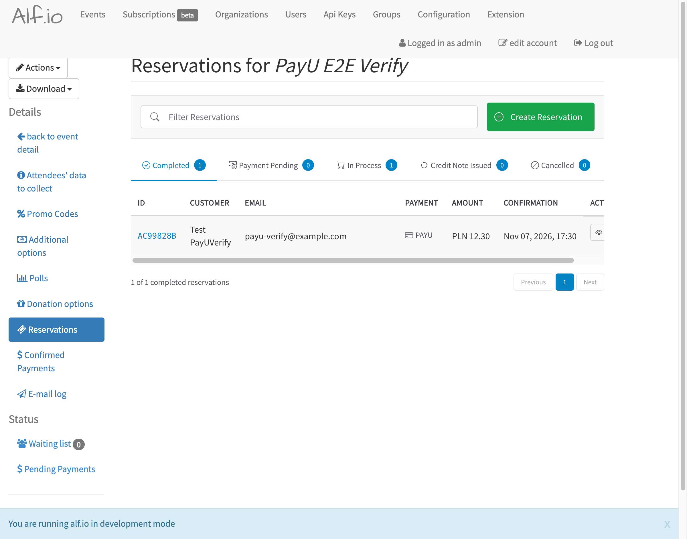

**Potwierdzone płatności**: zakładka **Confirmed Payments** pokazuje wszystkie zaksięgowane wpłaty. Można je wyeksportować przyciskiem **Export**.

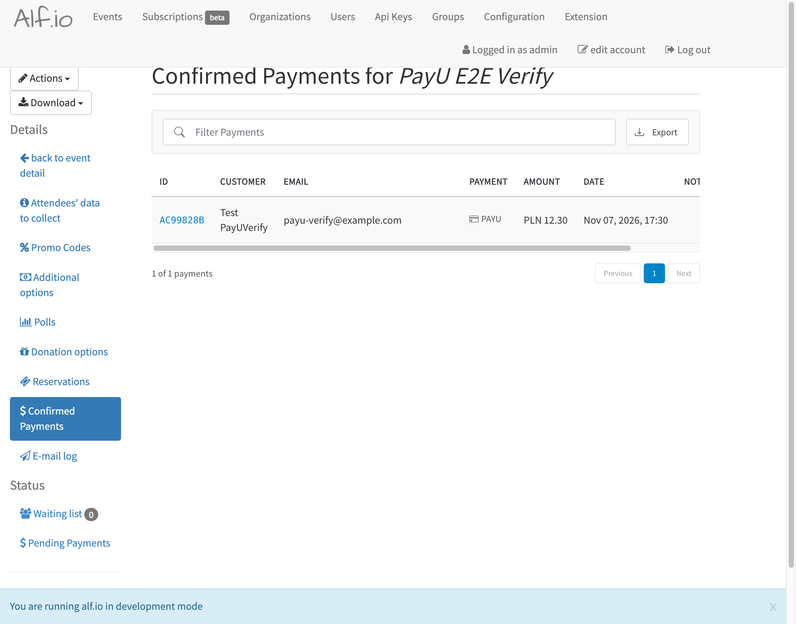

**Co oznaczają zakładki rezerwacji**:
- **Completed**: opłacone i potwierdzone,
- **In Process**: uczestnik jest w trakcie zamawiania albo płacenia (także w trakcie płatności w PayU),
- **Payment Pending**: czeka na wpłatę (np. przelew tradycyjny),
- **Cancelled**: anulowane.

💡 **Wskazówka**: rezerwacje, które długo wiszą w stanie „w trakcie płatności”, opisuje [rozdział 11](#11-rozwiązywanie-problemów-organizator).

## 9. Zwrot pieniędzy (refund)

Zwrot przez PayU trafia na konto lub kartę, z której uczestnik zapłacił. Możesz zwrócić całość albo część kwoty.

### Zwrot częściowy lub dowolna kwota

1. Na liście rezerwacji kliknij identyfikator rezerwacji (np. `AC99828B`).
2. Znajdź kartę **Payment**. Widać w niej identyfikator płatności, datę, **Paid amount** (zapłacono) i **Refunded amount** (zwrócono do tej pory).
3. W polu **Refund an arbitrary amount** wpisz kwotę zwrotu, np. `50.00`.
4. Kliknij **Refund** i potwierdź.

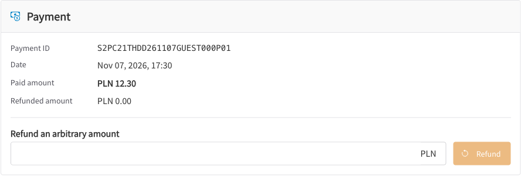

✅ **Co powinieneś zobaczyć**: po chwili kwota w **Refunded amount** się zwiększy (PayU księguje zwrot z niewielkim opóźnieniem).

### Zwrot całości przy anulowaniu rezerwacji

1. W szczegółach rezerwacji kliknij **Cancel reservation**.
2. W oknie potwierdzenia zostaw zaznaczoną opcję **Refund** z kwotą. Opcjonalnie zaznacz powiadomienie uczestnika.
3. Potwierdź przyciskiem **Cancel reservation**. Bilety zostaną zwolnione, a pełna kwota zwrócona.

⚠️ **Zanim ponowisz zwrot, który „nie wyszedł”**, sprawdź w panelu sprzedawcy PayU, w zwrotach dla tego zamówienia, czy zwrot nie został już wykonany. Ponowna próba po zwrocie, który w rzeczywistości przeszedł, zwróci pieniądze **drugi raz**.

## 10. Checklista uruchomienia produkcyjnego

Przejdź ją przed otwarciem sprzedaży biletów. Pełna wersja techniczna jest w `README.md` na gałęzi `plo-pl`, w sekcji „PayU go-live checklist / runbook”.

**Konfiguracja**
- [ ] Wszystkie sześć ustawień PayU jest na **jednym** poziomie (system **albo** organizacja).
- [ ] `PAYU_LIVE_MODE` jest włączone i wpisane są **produkcyjne** dane POS. Nie zostawiaj testowego POS z sandboxa.
- [ ] `BASE_URL` to **publiczny adres `https://`** instalacji (ten, który widzą uczestnicy). PayU wysyła powiadomienia o płatnościach na ten adres. Jeśli jest błędny, płatności nie będą się same potwierdzać.
- [ ] Serwer stoi za proxy HTTPS z limitem czasu odczytu co najmniej 120 sekund.

**Przed startem**
1. [ ] Usuń rezerwacje testowe zrobione na sandboxie.
2. [ ] **Test powiadomienia**: z komputera spoza sieci serwera sprawdź, czy adres powiadomień jest osiągalny. Odpowiedź HTTP 200 oznacza, że PayU „przejdzie” przez proxy i zaporę:
   ```
   curl -i -X POST -H 'Content-Type: application/json' -d '{}' \
     https://<adres-serwisu>/api/payment/webhook/payu/reservation/go-live-check
   ```
3. [ ] **Zakup testowy na sandboxie** pod publicznym adresem: zapłać, a na stronie PayU **zamknij kartę przeglądarki** przed powrotem do serwisu. Rezerwacja i tak musi przejść w stan „Completed”, wyłącznie dzięki powiadomieniu od PayU.

   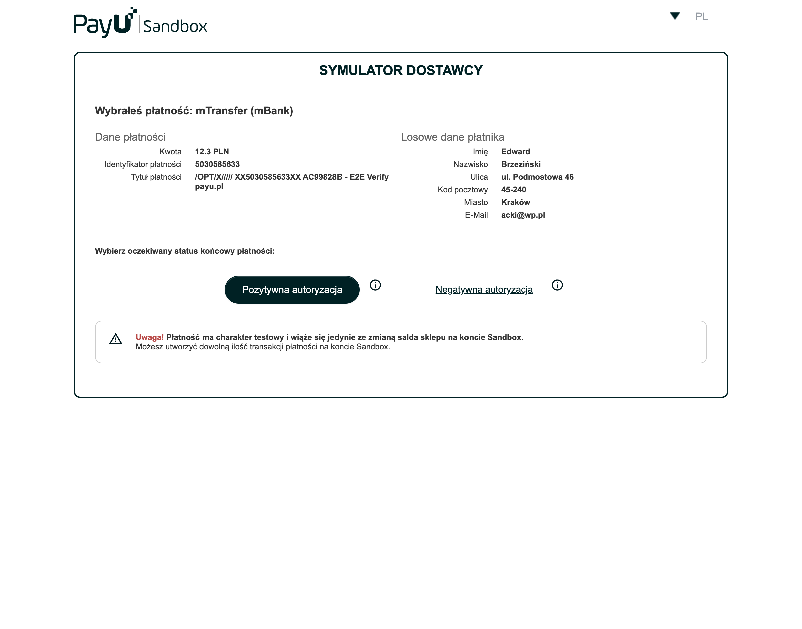

   ℹ️ W sandboxie zamiast prawdziwego banku pojawia się „Symulator dostawcy”. „Pozytywna autoryzacja” symuluje udaną płatność, „Negatywna autoryzacja” odrzuconą.
4. [ ] **Płatność testowa na produkcji**: przełącz na Live Mode i kup prawdziwy bilet za **1–2 zł** przez **BLIK**. Sprawdź, czy rezerwacja jest „Completed”, a potem **zwróć** tę kwotę z panelu (rozdział 9).

**Codziennie w trakcie sprzedaży**
- [ ] Sprawdź rezerwacje, które czekają na PayU, czyli stany `WAITING_EXTERNAL_CONFIRMATION`, `EXTERNAL_PROCESSING_PAYMENT` i `STUCK`. Zapytanie SQL jest w README.
- [ ] Jeśli któraś wisi za długo, uruchom dla niej **force-check** (sprawdzenie stanu w PayU):
  ```
  curl -X GET https://<adres-serwisu>/api/v2/public/reservation/<id-rezerwacji>/transaction/force-check
  ```
- [ ] Przejrzyj logi serwera pod kątem błędów (ERROR) z `alfio.manager.payment.PayUManager`, np. niezgodnej kwoty lub waluty albo anulowania, którego PayU nie wykonało.
- [ ] Przed ponowieniem zwrotu sprawdź zwroty w panelu PayU (patrz rozdział 9).

**Wycofanie zmian**: uruchom poprzednią wersję obrazu. Ta zmiana nie modyfikuje bazy danych.

## 11. Rozwiązywanie problemów (organizator)

| Problem | Prawdopodobna przyczyna | Co zrobić |
|---|---|---|
| Uczestnicy nie widzą opcji PayU | PayU nie jest zaznaczone w wydarzeniu, `PAYU_ENABLED` jest wyłączone albo waluta nie jest obsługiwana | Sprawdź rozdziały 6 i 7. Ustaw ceny w PLN |
| Po kliknięciu „Zapłać” pojawia się „Wystąpił nieoczekiwany błąd podczas komunikacji z PayU” | Błędne POS ID, client_id lub client_secret albo Live Mode niepasujący do kluczy | Porównaj klucze z panelem PayU i sprawdź przełącznik Live Mode |
| Płatność w PayU przeszła, ale rezerwacja się nie potwierdza | Powiadomienie od PayU nie dociera (zły `BASE_URL`, proxy, zapora) albo błędny second key | Uruchom force-check dla rezerwacji, sprawdź `BASE_URL` i drugi klucz, zrób test powiadomienia z rozdziału 10 |
| Rezerwacja ma status `STUCK` | System nie mógł ustalić stanu płatności | Uruchom force-check i sprawdź zamówienie w panelu PayU |
| W logach jest błąd niezgodności kwoty lub waluty | Zapłacona kwota różni się od kwoty rezerwacji | Rezerwacja nie zostanie potwierdzona automatycznie. Wyjaśnij sprawę z uczestnikiem i w razie potrzeby zwróć pieniądze ręcznie |
| Zwrot „nie wyszedł” | Przekroczony czas odpowiedzi PayU | Najpierw sprawdź zwroty w panelu PayU, dopiero potem ponów |

## Powiązane materiały
- `README.md` na gałęzi `plo-pl`, sekcja „PayU go-live checklist / runbook”: pełna wersja techniczna checklisty.
- Specyfikacja techniczna: `implementation/spec.md` w tym katalogu zadania.
- Dokumentacja PayU dla sprzedawców: panel sprzedawcy PayU, zakładka punktów płatności (POS).
